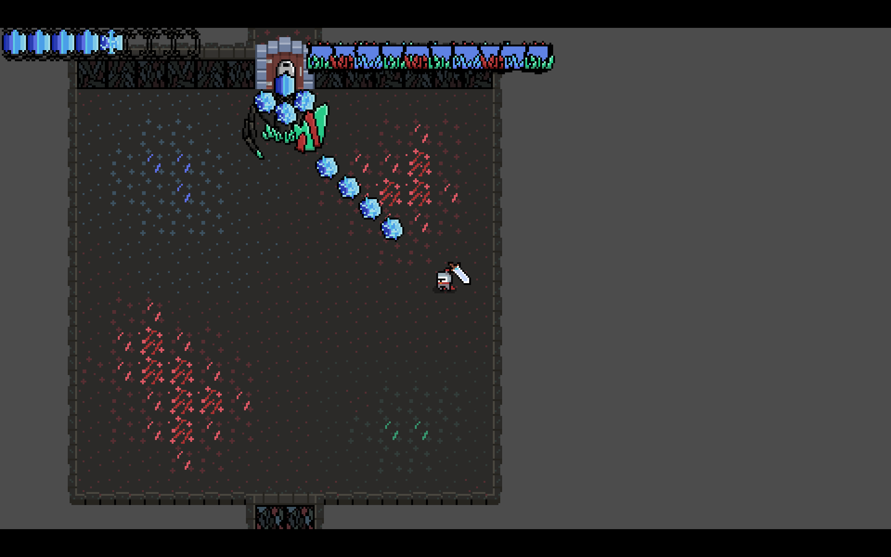
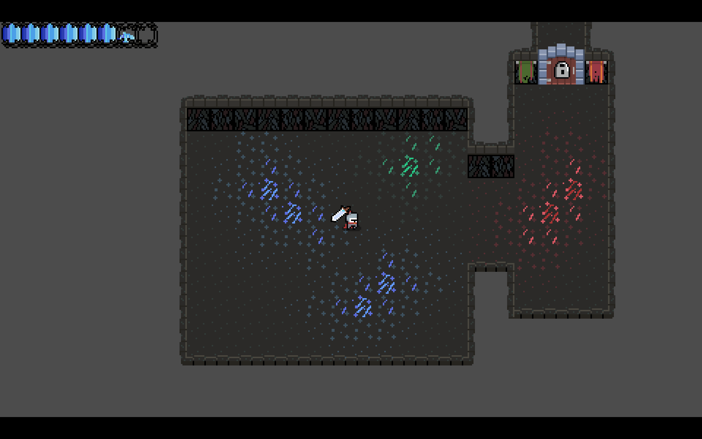

# Bloodshot
This is my attempt at really making the game I've wanted to make in some form for a year now.

It is a Crystal/Blood themed roguelite that focuses on precise and fun gameplay, with (hopefully) beautiful visuals and music (some day), made using Godot 4.

I'm using Hack Club's Terra event to motivate myself to get this started at the very least, hopefully I get that free laptop :P

To play the game, click on the "Releases" tab on the right, select which version of Bloodshot you want to try, and download the version for your operating system. Mac users will need to unzip the folder before being able play it. For windows and linux, this is a standalone executable file that should just launch the game when you double click it. If your operating system spits out something like "select a program to open this file with", right click it, go to properties, and set "allow executing file as program" to true. This lets you run the file as its own program.

Also, this project was initially following Matinator's Godot Roguelike tutorial for me to better understand how to structure a game properly.

This tutorial is a youtube series starting with this video: https://www.youtube.com/watch?v=axMNUTmFEDA&list=PL2-ArCpIQtjELkyLKec8BaVVCeunuHSK9

Images as requested by a Terra reviewer :D

 
